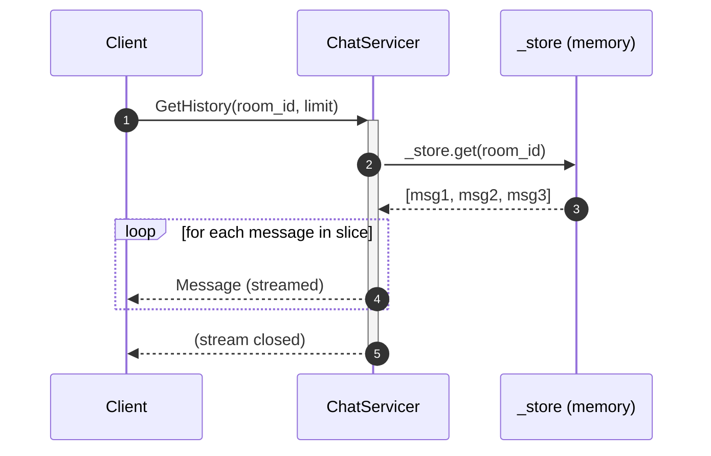
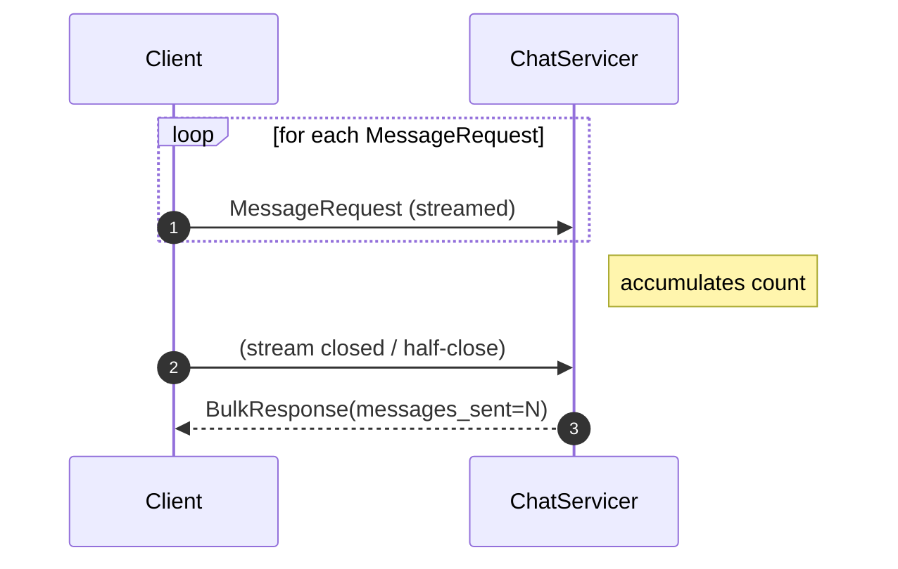
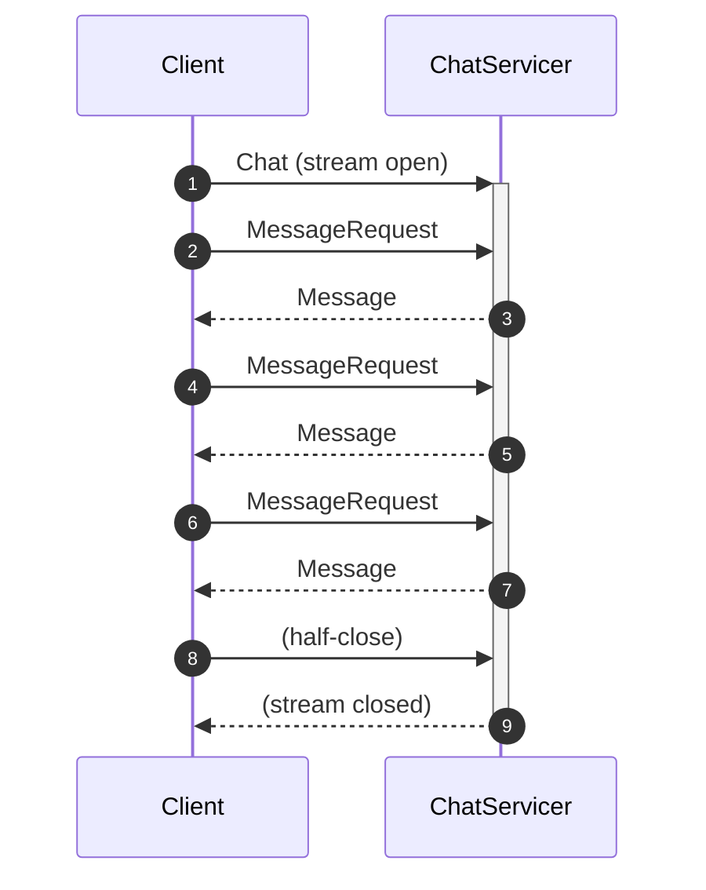

# Exercise 5: Streaming Patterns 

**Estimated time:** ~25 min

## Goal

Complete all four communication patterns on the server by adding the three
streaming ones — unary `SendMessage` is already done in Exercise 3 — and test
each from the client.

This exercise has three required parts:
- server streaming (`GetHistory`)
- client streaming (`SendBulkMessages`)
- bidirectional streaming (`Chat`)

## Prerequisites

Have your server running (`poe server`) so you can test the client side
independently while you iterate on the servicer methods below.

## Message flows

**Server streaming — `GetHistory`** (one request, many responses):



**Client streaming — `SendBulkMessages`** (many requests, one response):



**Bidirectional — `Chat`** (many requests, many responses interleaved):



> **Required vs bonus:** Tasks 1–3 below are required. `streaming_starter.py`
> additionally marks a few *bonus* experiments inside `demo_bidirectional`
> (pausing between yields, signalling half-close, passing a timeout) — skip
> them if you are short on time and come back later.

## Required Tasks

### Task 1 — Server streaming: `GetHistory`

In `exercises/server.py`, inside `ChatServicer`, implement
`GetHistory(self, request, context)`:

```python
def GetHistory(self, request, context):
    messages = _store.get(request.room_id, [])
    limit = request.limit if request.limit > 0 else len(messages)
    for msg in messages[-limit:]:
        yield msg   # ← key: just yield, gRPC handles the stream
```

Client side — iterate the result like a generator:

```python
for message in stub.GetHistory(
    chat_pb2.HistoryRequest(room_id="general", limit=10)
):
    print(f"[{message.user}] {message.content}")
```

### Task 2 — Client streaming: `SendBulkMessages`

```python
def SendBulkMessages(self, request_iterator, context):
    sent = 0
    for request in request_iterator:   # ← iterate the stream
        _make_message(request)   # stores it and returns the saved Message
        sent += 1
    return chat_pb2.BulkResponse(messages_sent=sent, messages_failed=0)
```

Client side — pass a **generator** as the argument:

```python
def messages():
    for i in range(10):
        yield chat_pb2.MessageRequest(room_id="general", user="alice", content=f"bulk {i}")

response = stub.SendBulkMessages(messages())
print(f"Sent: {response.messages_sent}")
```

### Task 3 — Bidirectional streaming: `Chat`

```python
def Chat(self, request_iterator, context):
    for request in request_iterator:   # ← iterate the stream, like SendBulkMessages
        msg = _make_message(request)
        yield msg   # ← key: yield inside the loop, so replies interleave with requests
```

Client side — pass a **generator** as the argument, same as `SendBulkMessages`,
but this time iterate the replies as they stream back:

```python
def requests():
    for text in ["Hi there!", "How does gRPC work?", "Thanks, goodbye!"]:
        yield chat_pb2.MessageRequest(room_id="general", user="alice", content=text)

for reply in stub.Chat(requests()):
    print(f"← [{reply.user}] {reply.content}")
```

## Test it

```bash
# Start server
poe server

# First send a couple of messages so history is non-empty
poe client-send --room general --user alice "first"
poe client-send --room general --user alice "second"

# Server streaming — get history
poe client-history --room general --limit 5

# Client streaming — send 5 messages in one call, then read them back
poe client-bulk --room general --count 5
poe client-history --room general --limit 10

# Bidirectional chat (interactive)
poe client-chat --room general --user alice
```

**Running with Docker?** `starter-05` connects to `localhost:50051`, so it has to
run inside the server container:

```bash
docker compose up server                            # terminal 1
docker compose exec server uv run poe starter-05    # terminal 2
```

`uv run` is required: `exec` skips the entrypoint and the venv in `/opt/venv`
is not on `PATH`.


Open `streaming_starter.py` to write your experiments.

## Verify

Run just this exercise's tests (regenerates the stubs first):

```bash
poe test-05
```

`poe test-exercises` runs all of them.

> **Restart the server after every change to `server.py`.** `poe server` loads
> your code once at startup, so edits are not picked up by the running process:
> stop it with Ctrl-C and start it again. If you get `UNIMPLEMENTED` or
> `INTERNAL` for a method you just wrote, this is almost always why.
>
> Restarting also clears `_store`, which lives in memory — the message history
> from before the restart is gone, so send a few fresh messages before testing
> `GetHistory`.

## ✅ Micro-check

**Task 1 (GetHistory)** — after sending a few messages, history should stream
each one back:

```
[alice] first
[alice] second
```

If it prints nothing, the room name in `HistoryRequest` doesn't match the one
you sent to — double-check `room_id`.
If you get `UNKNOWN: Exception iterating responses: 'NoneType' object is not
an iterator`, `GetHistory` is still `pass` in `server.py` — a streaming method
has to `yield`. `UNIMPLEMENTED` would mean the method is missing altogether.

**Task 2 (SendBulkMessages)** — `poe starter-05` should print:

```
Sent: 5   (or however many your generator yields)
```

If `messages_sent` is 0, the `for request in request_iterator` loop isn't
reached — make sure you're passing the generator object, not calling it
(`messages()` not `messages`).

**Task 3 (Chat)** — `poe client-chat` should echo each typed line back with a
`←` prefix. If nothing comes back, `Chat` isn't yielding — check that you
call `_make_message` and `yield` the result.

## Fell behind?

<details>

<summary>Click to view Solution 5-server (complete `server.py`)</summary>

If you fell behind, paste this whole file into `exercises/server.py` — it
contains all four methods (`SendMessage` from Exercise 3 plus the three
streaming ones) so you can catch up and continue.

```python
import uuid
from concurrent import futures

import grpc
from google.protobuf.timestamp_pb2 import Timestamp
from grpc import StatusCode

from exercises.generated import chat_pb2, chat_pb2_grpc

# In-memory message store: room_id → list[Message]
_store: dict[str, list[chat_pb2.Message]] = {}


def _make_message(request: chat_pb2.MessageRequest) -> chat_pb2.Message:
    timestamp = Timestamp()
    timestamp.GetCurrentTime()
    msg = chat_pb2.Message(
        message_id=str(uuid.uuid4()),
        room_id=request.room_id,
        user=request.user,
        content=request.content,
        timestamp=timestamp,
    )
    _store.setdefault(request.room_id, []).append(msg)
    return msg


class ChatServicer(chat_pb2_grpc.ChatServiceServicer):
    def SendMessage(self, request, context):
        """Unary — one request in, one response out (Exercise 03)."""
        if not request.content:
            context.abort(
                StatusCode.INVALID_ARGUMENT, "Message content cannot be empty"
            )
        msg = _make_message(request)
        return chat_pb2.MessageResponse(
            message_id=msg.message_id,
            status="ok",
            timestamp=msg.timestamp,
        )

    def GetHistory(self, request, context):
        """Server streaming — one request in, many responses out."""
        messages = _store.get(request.room_id, [])
        # proto3 default: limit == 0 means "not provided" → return everything.
        limit = request.limit if request.limit > 0 else len(messages)
        for msg in messages[-limit:]:
            yield msg

    def SendBulkMessages(self, request_iterator, context):
        """Client streaming — many requests in, one response out."""
        sent = 0
        failed = 0
        for request in request_iterator:
            if not request.content:
                failed += 1
                continue
            _make_message(request)
            sent += 1
        return chat_pb2.BulkResponse(messages_sent=sent, messages_failed=failed)

    def Chat(self, request_iterator, context):
        """Bidirectional streaming — replies interleave with requests."""
        for request in request_iterator:
            msg = _make_message(request)
            yield msg


def serve(port: int = 50051) -> None:
    server = grpc.server(futures.ThreadPoolExecutor(max_workers=10))
    chat_pb2_grpc.add_ChatServiceServicer_to_server(ChatServicer(), server)
    server.add_insecure_port(f"[::]:{port}")
    try:
        server.start()
        print(f"gRPC server listening on :{port}")
        server.wait_for_termination()
    finally:
        server.stop(grace=5)
```

</details>
