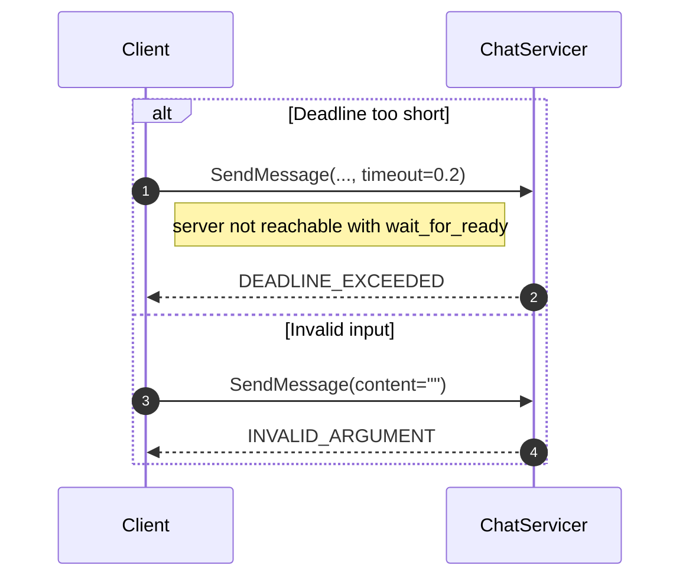

# Exercise 6: Deadlines and Error Handling 

## Goal

Learn how to make gRPC clients more resilient by handling:
- **Deadlines** (`DEADLINE_EXCEEDED`)
- **Status-based errors** (for example `INVALID_ARGUMENT`)

## Context

In real systems, RPCs can fail for many reasons:
- server is slow or unavailable
- caller gives invalid input

Your client should classify failures by **status code** and react cleanly.

## Message flow



## Your task

Open `deadlines_starter.py` and fill in `demo_deadline_exceeded` and
`demo_invalid_argument`.

### Task 1 — Deadline demo

1. Open an `insecure_channel` to `UNREACHABLE_SERVER` (use a context manager)
2. Create a `ChatServiceStub`
3. Call `stub.SendMessage(...)` with a `MessageRequest`, passing `timeout=0.2`
   and `wait_for_ready=True`
4. Catch `grpc.RpcError` and print `error.code()`

`wait_for_ready=True` tells gRPC to keep retrying the connection instead of
failing fast with `UNAVAILABLE` — that's what turns this into a
`DEADLINE_EXCEEDED` once the timeout elapses.

### Task 2 — Error handling demo

The channel and stub are already created for you against `EXERCISE_SERVER`:

1. Call `stub.SendMessage(...)` with an empty `content`
2. Catch `grpc.RpcError` and print both `error.code()` and `error.details()`

## Run it

```bash
# Terminal 1
poe server

# Terminal 2
poe starter-06
```

**Running with Docker?** `starter-06` connects to `localhost:50051`, so it has to
run inside the server container:

```bash
docker compose up server                            # terminal 1
docker compose exec server uv run poe starter-06    # terminal 2
```

`uv run` is required: `exec` skips the entrypoint and the venv in `/opt/venv`
is not on `PATH`.


## Bonus — cancellation

The directory is named `..._cancellation_...`, so here is the part the two
tasks above don't cover: who stops a call that is still running.

**Client side** — a streaming call returns a call object, not just an iterator,
and it has `.cancel()`:

```python
call = stub.GetHistory(chat_pb2.HistoryRequest(room_id="general", limit=0))
for message in call:
    print(message.content)
    call.cancel()        # stop after the first one
    break
```

Iterating the call afterwards raises `grpc.RpcError` with
`StatusCode.CANCELLED`. Note that `.future()` exists only for *unary* calls —
streaming calls give you `.cancel()` on the call object itself.

**Server side** — the servicer can notice that nobody is listening any more:

```python
def GetHistory(self, request, context):
    for message in _store.get(request.room_id, []):
        if not context.is_active():     # client went away
            return
        yield message
```

`context.add_callback(fn)` registers `fn` to run when the call ends, however it
ends — the usual place to release per-call resources.

## Verify

Run just this exercise's tests (regenerates the stubs first):

```bash
poe test-06
```

`poe test-exercises` runs all of them.

## ✅ Micro-check

You should see output similar to:

```text
[Deadline] code=DEADLINE_EXCEEDED
[Error] code=INVALID_ARGUMENT details=Message content cannot be empty
```

If deadline shows `UNAVAILABLE`, check that your call uses `wait_for_ready=True`.

